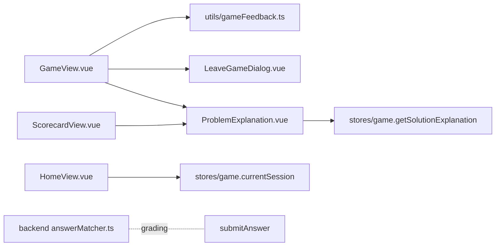

# Game interface improvements — Design

**Spec:** ./spec.md   **Last updated:** 2026-11-12
**Status:** Current

## Overview

Most of the change is presentational and lives in `GameView.vue`. The pure logic (praise, streak, format tip, displayed problem number) moves into a small tested module, `utils/gameFeedback.ts`. Two new small components keep `GameView` readable: `LeaveGameDialog.vue` (native `<dialog>`) and `ProblemExplanation.vue`, which loads the explanation with a "latest request wins" guard and is shared by the game and the scorecard. The backend changes only `answerMatcher.ts` (also used by answer verification, see ADR-6): a symmetric "strip decorations" step runs before the numeric comparison. Nothing is stored differently and no API changes, so a code revert fully restores the previous behaviour.

## Experience

**Design review (approved by Miguel, 2026-11-12).**
- Round 1: three choices were offered.
  - Scope: High+Medium+bugs / first batch / everything. Picked "everything".
  - Wrong-answer flow: echo + Show me how / auto-explain / echo only. Picked "echo + Show me how".
  - Card layout: chips + labelled hint / one info line. Picked "chips + labelled hint".
  - Lenient grading: strip / guidance only. Picked "strip".
- Round 2: refined screens A–H, approved as shown:

```
A  Problem                                 C  Correct
┌──────────────────────────────────┐      │          Nailed it! 🎉           │
│ ✕ Exit        Problem 3 of 10    │      │   +10 points  · 🔥 3 in a row    │
│ ▓▓▓▓▓▓░░░░░░░░░░  Score 25 🔥 2  │      │   [      Next Problem  →     ]   │
├──────────────────────────────────┤
│ [Fractions]          [⭐ 10 pts] │      D  Wrong
│  What is 1/4 + 2/4?   (≥1.5rem)  │      │        Not quite right           │
│  Your answer                     │      │   You said      12/4             │
│  ┌────────────────────────────┐  │      │   Answer        3/4              │
│  └────────────────────────────┘  │      │   [ 💡 Show me how ]             │
│  Tip: type it like 3/4 or 1 1/2  │      │   ┌ explanation + numbered steps ┐│
│  [        Submit Answer       ]  │      │   [      Next Problem  →     ]   │
│  [ 💡 Hint  −5 pts · 2 left   ]  │
└──────────────────────────────────┘      E  Exit dialog
                                          │  Leave this game?            │
                                          │  Your progress is saved. You │
                                          │  can continue it from Home.  │
                                          │  [ Keep playing ] [ Leave ]  │
```
- B: "You already used N hint(s) on this problem (−5N pts)."
- F: Home's existing Continue card is shown for an unfinished game held in memory.
- G: "We couldn't load your game." with [Back to Home].
- H: the counter fix, Enter hint hidden on touch, reduced motion, and 3 px focus rings.

Deviation from the review: the full keyboard is used instead of an on-screen symbol row. The user saw this and approved it.

**States and copy**

| State | What the kid sees | Way forward |
|---|---|---|
| Loading a game | existing "Loading your math problems" or the overlay | waits |
| Load failure (`!isLoading && !currentProblem`) | "We couldn't load your game." | [Back to Home] |
| Answering | A; tip from `formatTip(problem)` | Submit, Hint, Exit |
| Hint loading / hint shown | button shows "Getting hint..."; hint list (live region) | keep answering |
| Hint failed | existing global error toast (unchanged); the announcer only speaks on hint success | button re-enabled |
| Resumed with used hints | B line inside the hints box | keep answering |
| Submit failed / 409 | existing inline error (unchanged) | retry |
| Correct | C, praise rotating by `attempts.length`; the streak line and the header 🔥 only appear when the streak is ≥2 | Next / View Scorecard |
| Correct, 0 pts | "Correct! The hints used up this one's points, but you solved it 💪" | Next |
| Wrong | D, echoing the typed answer | Show me how, Next |
| Explanation loading / loaded / failed | "Working it out..." / text + `<ol>` steps / "Couldn't load the explanation." | [Try again], Next |
| Leave attempt | E (`<dialog>`, Keep playing has autofocus; at ≤480 px the buttons stack full-width with Keep playing on top) | Keep playing, Leave, Esc = keep playing |

## Architecture



- **`utils/gameFeedback.ts`** (pure, unit-tested):
  - `formatTip(problem): string` (AC2).
  - `praiseFor(attemptIndex): string`, cycling through the 4 phrases (AC7).
  - `currentStreak(attempts): number`, counting consecutive `isCorrect` answers from the end (AC7).
  - `displayedProblemNumber(session, problem): number`, the 1-based index of `problem` in `session.problems`, falling back to `currentProblemIndex + 1` (AC9).
  - `answeredCount(session): number`, the `attempts.length` (AC9 progress bar).
  - `hintPenaltyLine(used): string` (AC6).
- **`GameView.vue`:**
  - Input: `inputmode="text" autocapitalize="off" autocorrect="off" spellcheck="false"` (AC1). Remove `answerInputMode`.
  - Header: an Exit button (`aria-label="Exit game"`) that calls `router.push({ name: 'home' })`, so it goes through the same guard as the logo and back (AC10).
  - The points chip and hint label in the template (AC4, AC5).
  - `feedback` gains `kind: 'correct' | 'wrong'`, `userAnswer`, `correctAnswer`, `pointsEarned`, `streak` and `problemId`. The text is built from `gameFeedback.ts`.
  - Announcements (AC14): screen readers often stay silent when a live region is inserted already holding text. So a single **always-mounted**, visually hidden `<div role="status" aria-live="polite" class="sr-only" data-test="announcer">` sits at the top of `.game-view`; only its text changes. It is set to the feedback headline and detail on submit (e.g. "Nailed it! +10 points"), to "Hint N: {text}" when a hint arrives, and cleared on the next problem. The visible feedback card and hints list stay as they are (without live attributes, to avoid double reading).
  - Enter on the feedback card: change `@keyup.enter="handleNextProblem"` to `@keyup.enter.self`, so Enter only advances when the card itself has focus. Enter on "Show me how", "Try again" or "Next" acts on that button only; "Next" advances through its own click (AC8).
  - `onBeforeRouteLeave((to) => …)`. The allow-list:
    - `to.name === 'scorecard'`
    - `!gameStore.currentSession`
    - the session `isCompleted`
    - `!gameStore.currentProblem` (state G: nothing to protect)
    - `leaveConfirmed`

    Otherwise store `to`, open the dialog and `return false`. Leave sets `leaveConfirmed = true` and calls **`router.replace(pendingTo)`**. If the dialog is already open, a repeated attempt (e.g. Back pressed again) just returns `false`, without calling `showModal()` again. `to.name === 'login'` is also allowed, so a session-expiry redirect is never stuck behind the dialog even if `logout()` throws before resetting the store, so a later Back doesn't land on `/game` again (AC10).
    - Logout and session expiry (`main.ts` handler) call `authStore.logout()`, which resets the game store before navigating, so the guard allows them.
    - The global `requiresAuth` redirect to `/login` only runs when entering a route, never on a leave from `/game` in progress, so there's no conflict.
  - The `v-else` branch becomes the G state with a Back to Home button (AC12).
  - **Answered-but-not-advanced problem (AC11):** after a correct or wrong answer, the store has already advanced `currentProblemIndex`, but `currentProblem` is still the answered one, and `feedback` lives only in the view. If the kid leaves while feedback is showing and later continues, `onMounted` sees that `currentSession.attempts` already contains `currentProblem.id` and calls `gameStore.loadNextProblem()` before focusing. Continue therefore shows the **next** problem, or ends the game and routes to the scorecard if it was the last. A previous answer is never offered for resubmission (which would 409).
- **`LeaveGameDialog.vue`:**
  - A native `<dialog>` opened with `showModal()` on an `open` prop. It emits `stay` and `leave`. Any `close` event not caused by Leave (Escape, with or without `cancel`) emits `stay`.
  - "Keep playing" has `autofocus`.
  - The page behind it is inert while it's open.
- **`ProblemExplanation.vue`:**
  - Props: `problemId: string`, `autoload?: boolean` (default false).
  - Focus: when the explanation loads, the button is replaced by the explanation container (`tabindex="-1"`), which receives focus. On error, focus moves to Try again. Focus never drops to `body`.
  - On `load()` it increments a request token, and ignores a response whose token is stale or whose `problemId` has changed (AC8, AC13).
  - States: idle / loading / loaded / error.
  - The game shows it in idle state with a "💡 Show me how" button. The scorecard mounts it with `autoload`, keeping today's behaviour of loading when a problem is expanded.
  - Uses the existing store method `getSolutionExplanation` and the type `SolutionExplanation`.
- **`HomeView.vue`:** if `gameStore.currentSession` exists and isn't completed, set `resumable` from it (`sessionId`, `difficulty`, `startTime`). `continueGame` then routes straight to `game` without refetching (AC11). Otherwise today's server lookup runs.
- **`ScorecardView.vue`:** the inline explanation block is replaced by `<ProblemExplanation autoload>` (AC13).
- **CSS:**
  - `style.css`:
    - A global `:focus-visible { outline: 3px solid #4c51bf; outline-offset: 2px }` for buttons, inputs, `[tabindex]` and dialog buttons (AC15). The `outline: none` on `.form-group input:focus` and `.feedback-card:focus` is replaced so that `:focus-visible` wins.
    - A global reduced-motion block (AC17).
  - `GameView` CSS:
    - The question at `1.5rem` at both breakpoints (AC16).
    - `.hint-penalty` set to `#a71d2a`: 6.65:1 on `#fff3cd`, computed with the WCAG relative-luminance formula (AC16).
    - `.hint-text` hidden under `(hover: none) and (pointer: coarse)` (AC18).
    - Secondary text on the feedback cards darkened to `#495057`.
- **Backend `answerMatcher.ts`:** a new `parseDecorated(s): { value: number, unit: string | null } | null`. `checkAnswerCorrect` runs one extra step after the existing ones (AC3): when both sides parse, the values must match within 1e-9, **and** if both sides carry a unit, the units must be the same after canonicalisation. Unit splitting runs on the **un-collapsed** string, with `\s*` allowed around units and superscripts, so `6 square feet`, `45 °`, `12 cm ²` and `1 1/2 cm` parse. Whitespace collapsing only happens inside `numericValue` on the remaining number, which keeps the existing mixed-number handling. `parseDecorated`, in order:
  1. Lowercase and trim.
  2. Drop a leading `^[a-z]\s*=\s*`.
  3. Drop a leading `$`.
  4. Split off a trailing unit only if it is on the **allowlist**:
     - length: `mm cm m km in inch inches ft foot feet yd yard yards mi mile miles`
     - mass: `g kg mg lb lbs oz`
     - volume: `l ml liter liters litre litres`
     - time: `s sec secs second seconds min mins minute minutes h hr hrs hour hours day days week weeks year years`
     - angle: `degree degrees °`
     - `square <length>`, `cubic <length>`, and a length followed by `²` or `³`

     Canonicalisation maps plurals and spellings to one form (`feet` → `ft`, `degrees`/`°` → `°`). A one-letter unit (`m g h s l`) only splits off when whitespace separates it from the number (`3 m`); stuck to a number (`3m`) it is an algebra variable. Found at the Verify gate. Anything else, such as `x`, `pi`, `i`, `n` or `apples`, is not split off, so `3x`, `2pi` and `4 i` never become numbers.
  5. If the rest matches `^-?\d{1,3}(,\d{3})+(\.\d+)?$`, remove the commas.
  6. Return `numericValue(rest)` (null if not numeric) and the unit.

  Leniency only applies when both sides parse as numbers, so text answers can't change.

## Data and contracts

No schema, API or event changes. `AnswerResult` and `SolutionExplanation` are used as they are.

## Decisions

### ADR-1: A native `<dialog>` for the leave confirmation
- **Context:** the confirmation must trap focus, close on Esc and make the page inert, for keyboard and screen-reader players.
- **Options:** A) native `<dialog>` + `showModal()`; B) a hand-built overlay `div` with a focus trap; C) `window.confirm`.
- **Decision:** A.
- **Why:** inertness, Esc and focus handling come from the browser, with no dependency. C can't be styled and reads as an error to kids.
- **Reversibility:** easy.
- **Sources:** see "Sources (lookup batch)" below, item 1.

### ADR-2: A route-leave guard instead of a click handler on each exit
- **Context:** the logo link, browser back and the new Exit button all leave the game.
- **Options:** A) vue-router `onBeforeRouteLeave` in `GameView`; B) intercepting each link and button.
- **Decision:** A.
- **Why:** one place covers every way out, including back and any future link.
- **Reversibility:** easy.
- **Sources:** item 6.

### ADR-3: Full keyboard (`inputmode="text"`) for all answers
- **Context:** the decimal keypad can't type `-`, `/` or space.
- **Options:** A) `text` everywhere; B) on-screen symbol row; C) a smarter per-topic choice.
- **Decision:** A.
- **Why:** it's the simplest choice that never blocks a valid answer, and per-topic guessing (today's approach) is what failed. The cost is a slower keypad for pure integers.
- **Reversibility:** easy.
- **Sources:** item 2.

### ADR-4: Symmetric, numeric-only leniency in the grader
- **Context:** units, `x =` and commas make right values count as wrong.
- **Options:** A) strip on both sides, numeric comparison only; B) ask the model to store normalized answers; C) frontend-only stripping.
- **Decision:** A.
- **Why:**
  - It also fixes stored answers that carry units.
  - It never touches text answers.
  - B needs a prompt change and doesn't fix existing sessions.
  - C can be bypassed and would duplicate the grader.
- **Units:** only allowlisted units are stripped, so variables and constants are never stripped. When both sides carry a unit they must match (`12 m` ≠ `12 cm`). A bare number matches a value with a unit (`12` = `12 cm`), and vice versa.
- **Reversibility:** easy (pure function).
- **Sources:** none external (pure string logic, covered by tests).

### ADR-5: Component tests with `@vue/test-utils` + jsdom (dev only)
- **Context:** most ACs are view behaviour, and the frontend has no component-test tooling (a follow-up from NINJA-12).
- **Options:**
  - A) add `@vue/test-utils` + `jsdom` as exact-pinned devDependencies;
  - B) only pure-function tests plus a manual headless-Chrome render;
  - C) Playwright E2E in CI.
- **Decision:** A for view tests, plus a headless-Chrome render recorded during Verify. The render harness lives in the scratchpad and isn't committed.
- **Wiring:** jsdom is enabled **per file** with a `// @vitest-environment jsdom` docblock on component tests only, so the existing store, service and util tests stay in node. No `test` block is added to `vite.config.ts`.
- **Dialog in tests:** jsdom's `showModal` support isn't relied on. Component tests stub `HTMLDialogElement.prototype.showModal` and `close`, with `close` dispatching a `close` event, and assert the real-dialog path. A separate test deletes `showModal` and asserts the `window.confirm` fallback (stubbed). Both paths are covered.
- **"Runs in CI":** the repo has no CI pipeline, so "CI" here means `cd frontend && npm test` and `cd backend && npm test`, run locally and recorded. AC15–AC18 (pure CSS) are proven by the recorded headless-Chrome render. Accepted, because committing a browser harness needs browser binaries the repo doesn't manage.
- **Why:** CI-runnable proof of view states at the cheapest level. C needs browser binaries in CI.
- **Reversibility:** easy.
- **Sources:** item 8.

### ADR-6: Answer verification shares the lenient matcher
- **Context:** `reconcileVerifiedAnswers` (`backend/src/utils/answerVerification.ts:32`) drops a generated problem when an independent solve "disagrees", using `checkAnswerCorrect`.
- **Options:** A) share the lenient matcher; B) keep a strict entry point for verification.
- **Decision:** A.
- **Why:** "agree" should mean what the grader would accept. A generated `12 cm` with a verified `12` is the same answer, and strict matching drops a valid problem. Mismatched units, and variables or constants, still disagree, so a real disagreement is still dropped. This only reduces false drops; the prompts and generation are unchanged.
- **Reversibility:** easy.
- **Sources:** none external (covered by tests).

## Failure modes

| Failure | Detection | Behavior | Recovery |
|---|---|---|---|
| Explanation request fails or times out | promise rejects | "Couldn't load the explanation." | Try again; Next still works |
| Explanation arrives after moving on | token or problem mismatch | ignored | none needed |
| `showModal` unsupported (very old browser) | `typeof dialog.showModal !== 'function'` | fall back to `window.confirm` with the same text | — |
| Leave guard blocks logout | the store is reset before navigation | guard allows (no session) | — |
| Leniency accepts something unintended | grader tests | only both-numeric comparisons are affected | revert `answerMatcher.ts` |

## Security and privacy

No new data, endpoints or dependencies at runtime. The echoed `userAnswer` is rendered with Vue text interpolation (escaped), never `v-html`. The explanation text is rendered as text too, as the scorecard already does. Known pre-existing issue (out of scope): `correctAnswer` is sent to the client with the session.

## Performance

No new network calls on the main path. "Show me how" makes one Bedrock-backed call, and only on demand. The bundle grows by two small components; check that the main chunk grows by less than 5 KB gzip.

## Migration and rollback

Frontend and backend deploy independently. The backend change only widens what counts as correct. Rollback: revert the PR and redeploy both. No data to undo, although attempts graded leniently stay graded.

## Traceability

| AC | Component(s) | Test(s) |
|---|---|---|
| AC1 | GameView input | GameView.test "full keyboard" + render |
| AC2 | gameFeedback.formatTip, GameView | gameFeedback.test, GameView.test |
| AC3 | backend answerMatcher.parseDecorated | answerMatcher.test "decorations" (positives, plus negatives `3x`, `2pi`, `4 i`, `12 m`≠`12 cm`, `1,5`, text) |
| AC4, AC5 | GameView | GameView.test |
| AC6 | gameFeedback.hintPenaltyLine, GameView | gameFeedback.test, GameView.test "resumed hints" |
| AC7 | gameFeedback.praiseFor/currentStreak, GameView | gameFeedback.test, GameView.test |
| AC8 | ProblemExplanation, GameView | ProblemExplanation.test, GameView.test "wrong answer" |
| AC9 | gameFeedback.displayedProblemNumber/answeredCount | gameFeedback.test, GameView.test |
| AC10 | LeaveGameDialog, GameView guard | LeaveGameDialog.test, GameView.test "leave guard" + render |
| AC11 | HomeView, GameView onMounted | HomeView.test "in-memory continue", GameView.test "continue after feedback shows next problem" |
| AC12 | GameView | GameView.test "load failure" |
| AC13 | ProblemExplanation, ScorecardView | ProblemExplanation.test "stale response", "retry" |
| AC14 | GameView announcer, `@keyup.enter.self` | GameView.test "announces results and hints", "Enter on Show me how doesn't advance" |
| AC15–AC18 | style.css, GameView CSS | `styles.test.ts` (node: parses `style.css` and `GameView.vue` and asserts the focus-visible, reduced-motion, coarse-pointer and phone font-size rules exist, plus the penalty colour's contrast ≥4.5:1 computed in-test) + headless-Chrome render: computed styles under emulated media |
| AC19 | all | full suites, vue-tsc, tsc, builds |

## Build notes (deviations)

- GameView's own CSS for AC16 and AC18 (phone question size, penalty colour, touch-only Enter hint, no `outline: none`) landed in the GameView commit (step 6). Step 8 only added the global rules and `styles.test.ts`.
- `LeaveGameDialog` needs `margin: auto`: the global `* { margin: 0 }` reset overrides the browser's centring of modal dialogs. Found in the headless render.
- Known limitation (Chrome): if Back is pressed within a few milliseconds of closing the dialog with Escape, Chrome's close-watcher rules can swallow the newly opened dialog. The navigation still stays cancelled and the kid stays in the game. Not reachable by a person; observed only under automation.
- `ProblemExplanation` stops `click`/`keydown`/`keyup` from propagating at its root. The scorecard row and the game card both react to these, so this is required, not optional.

## Risks and spikes

Riskiest assumption: `<dialog>` inside the vue-router guard flow, i.e. that returning `false` and then calling `router.replace(pendingTo)` after confirming works without loops. The `leaveConfirmed` flag prevents a loop. It is proven by GameView.test with a real router (`createMemoryHistory`) and by the headless render.

## Sources (lookup batch)

Delegated lookup, 2026-11-12. The npm and installed versions were checked directly; the docs claims were matched against these references:

1. `<dialog>` + `showModal()`: the page becomes inert, Escape fires `cancel` then `close`, and focus goes to the `[autofocus]` descendant. Baseline since 2022 (Chrome 37, Firefox 98, Safari 15.4). [MDN dialog](https://developer.mozilla.org/en-US/docs/Web/HTML/Element/dialog), [WHATWG](https://html.spec.whatwg.org/multipage/interactive-elements.html#the-dialog-element). **Caveat:** Chrome may skip `cancel` on a repeated Escape, so `LeaveGameDialog` treats any `close` that wasn't "Leave" as "Keep playing".
2. `inputmode="text"` gives the standard full keyboard. `decimal` gives digits plus a separator, and minus may be missing (iOS). [WHATWG inputmode](https://html.spec.whatwg.org/multipage/interaction.html#input-modalities:-the-inputmode-attribute). It is only a hint, so the format tip covers the gaps.
3. `:focus-visible`: Baseline 2022. [MDN](https://developer.mozilla.org/en-US/docs/Web/CSS/:focus-visible)
4. `prefers-reduced-motion`: Baseline 2020. [MDN](https://developer.mozilla.org/en-US/docs/Web/CSS/@media/prefers-reduced-motion)
5. `(hover: none) and (pointer: coarse)` reflects the *primary* input, so touch laptops may still show the Enter hint. Acceptable, because the hint is cosmetic. [Media Queries 4](https://drafts.csswg.org/mediaqueries-4/#hover)
6. vue-router 4.6.4 (installed): `onBeforeRouteLeave` cancels on `return false`. A params-only change uses `onBeforeRouteUpdate`, which doesn't apply since `/game` has no params. [Navigation guards](https://router.vuejs.org/guide/advanced/navigation-guards)
7. WCAG 2.2 SC 1.4.3: text 4.5:1. SC 1.4.11: UI components and focus indicators 3:1. [WCAG 2.2](https://www.w3.org/TR/WCAG22/#contrast-minimum)
8. `@vue/test-utils`: 2.5.1 is the latest (2026-09-16, peer `vue: 3.x`), but its `js-beautify` 2 chain carries moderate glob/minimatch advisories, so **2.4.11 is pinned** (2026-06-04, same peer range). `jsdom`: latest is 31.0.0 (2026-11-05, under two weeks old), so **pin 30.1.3**. Vitest 4.1.12 supports `environment: 'jsdom'` with `jsdom` installed. Neither package is deprecated.

## Implementation plan

<!-- ship-it: before dispatching the plan reviewer, extract this section
     and pass it alongside spec.md only. Do not pass the full design.md. -->

Self-contained: every decision a slice needs is restated here.

1. **Backend grader** (`backend/src/utils/answerMatcher.ts`).
   - Add `parseDecorated(s) → { value, unit } | null`, in this order:
     1. Lowercase and trim.
     2. Drop a leading `^[a-z]\s*=\s*`.
     3. Drop a leading `$`.
     4. On the un-collapsed string, split off a trailing unit only if it is on the allowlist:
        - length: `mm cm m km in inch(es) ft foot feet yd yard(s) mi mile(s)`
        - mass: `g kg mg lb(s) oz`
        - volume: `l ml liter(s) litre(s)`
        - time: `s sec(s) second(s) min(s) minute(s) h hr(s) hour(s) day(s) week(s) year(s)`
        - angle: `degree(s) °`
        - `square|cubic <length>`, and `<length>²|³`, with `\s*` allowed around units and superscripts.

        Canonicalise to one spelling.
     5. Remove commas only for `^-?\d{1,3}(,\d{3})+(\.\d+)?$`.
     6. Return `numericValue(rest)` (null if not numeric) and the unit.
   - `checkAnswerCorrect` gets a last step: if both sides parse, values within 1e-9, and when both have units, the units must be equal.
   - Tests first.
     - Positives: `x = 5`, `1,000`, `12,345.5`, `$1,250`, `12 cm`, `12cm`, `45°`, `45 °`, `45 degrees`, `6 square feet`, `6 ft²`, `12 cm ²`, `3 hours`=`3 hr`, `1/2 kg`, `1 1/2 cm`.
     - Rejected: `12 m`≠`12 cm`, `3`≠`3x`/`2pi`/`4 i`, `5`≠`5 apples`, `1,5`≠`1.5`/`15`, text answers unchanged.
   - In `answerVerification.test.ts`: a generated `12 cm` with a verified `12` is kept; `12 m` and `3x`/`3` are dropped.
   - `cd backend && npm test`. Commit.
2. **Test tooling.** Install from the repo root with the public registry, exact pins: `@vue/test-utils@2.4.11` (2.5.x pulls `js-beautify` 2 with moderate glob/minimatch advisories) and `jsdom@30.1.3`. Component tests opt in with a `// @vitest-environment jsdom` docblock; there is no global test config. Commit.
3. **`frontend/src/utils/gameFeedback.ts`** plus tests. Exports:
   - `formatTip`: text answer → "Tip: a word or short phrase"; topic `Fractions` → "Tip: type it like 3/4 or 1 1/2"; else "Tip: just the number, like 12 or -3.5".
   - `PRAISE`: Correct!, Nailed it!, Great job!, You got it!
   - `praiseFor(i)`: `PRAISE[i % 4]`
   - `currentStreak(attempts)`
   - `displayedProblemNumber(session, problem)`: index of `problem` in `session.problems`, plus 1, capped at the total; falls back to `currentProblemIndex + 1`.
   - `answeredCount(session)`
   - `hintPenaltyLine(n)`: "You already used N hint(s) on this problem (−5N pts)."

   Commit.
4. **`frontend/src/components/ProblemExplanation.vue`.**
   - Props `problemId`, `autoload?`. States idle / loading ("Working it out...") / loaded / error ("Couldn't load the explanation." + Try again).
   - Calls `gameStore.getSolutionExplanation(problemId)`. A `null` result counts as an error.
   - A request token means only the latest response may render; a `problemId` change resets the state (and reloads when `autoload` is set).
   - On load, focus moves to the explanation container (`tabindex="-1"`); on error, focus moves to Try again.
   - The root stops `click`, `keydown` and `keyup` propagation, because the parent scorecard row is clickable and the feedback card advances on Enter.
   - Swap the `ScorecardView` inline explanation for `<ProblemExplanation autoload>`; `toggleExplanation` only toggles.
   - Tests: idle → click → loading → loaded with steps and focus; autoload; error → retry recovers; stale response ignored; propagation stopped.

   Commit.
5. **`frontend/src/components/LeaveGameDialog.vue`.**
   - Native `<dialog>`. When the `open` prop becomes true and `!dialog.open`, call `showModal()`.
   - Copy: "Leave this game?" / "Your progress is saved. You can continue it from Home.", then [Keep playing] (`autofocus`) and [Leave].
   - Emits `leave` (Leave button) or `stay` (Keep playing, or any `close` not caused by Leave, e.g. Escape, with or without `cancel`).
   - Fallback when `showModal` isn't a function: `window.confirm(<same text>)`, emitting `leave` or `stay`.
   - At ≤480 px the buttons stack full-width, Keep playing on top.
   - Tests stub `HTMLDialogElement.prototype.showModal`/`close` (with `close` dispatching `close`), and separately cover the confirm fallback.

   Commit.
6. **`frontend/src/views/GameView.vue`.** Tests use a real Pinia store, a real router (`createMemoryHistory`, real route table), and `gameService` mocked at the module boundary.
   - Input: `inputmode="text" autocapitalize="off" autocorrect="off" spellcheck="false"`; remove `answerInputMode`. Show `formatTip` under the input.
   - Problem card: chip `⭐ {maxPoints} pts`. Hint button "💡 Hint −5 pts · {2 − used} left".
   - Hints: if `hintsUsedCount > hintsReceived.length`, show `hintPenaltyLine(hintsUsedCount)` in the hints box.
   - Header:
     - "Problem {displayedProblemNumber} of {total}"
     - progress `answeredCount / total`
     - `🔥 {streak}` only when streak ≥ 2
     - an "✕ Exit" button (`aria-label="Exit game"`) that calls `router.push({ name: 'home' })`
   - Feedback, correct: `praiseFor(attempts.length − 1)`, "+N points", and "🔥 S in a row" when S ≥ 2. A correct answer that earned 0 points shows "Correct! The hints used up this one's points, but you solved it 💪".
   - Feedback, wrong: "Not quite right", "You said {typed}", "Answer {correctAnswer}", then `<ProblemExplanation :problem-id>`.
   - The card's `@keyup.enter` becomes `@keyup.enter.self`.
   - Announcer: one always-mounted `<div role="status" aria-live="polite" class="sr-only" data-test="announcer">`. Its text is:
     - correct: "{praise} +N points"
     - wrong: "Not quite right. The answer is {correctAnswer}."
     - hint success: "Hint N: {text}"

     It clears on the next problem. No live attributes go on the visible cards.
   - Leave guard: `onBeforeRouteLeave`. Allow when:
     - `to.name` is `scorecard` or `login`
     - there is no `currentSession`
     - the session `isCompleted`
     - there is no `currentProblem`
     - `leaveConfirmed` is set

     Otherwise remember `to`, open the dialog (or return `false` if it's already open) and return `false`. On `leave`, set `leaveConfirmed` and `router.replace(pendingTo)`. On `stay`, close the dialog and refocus the input or feedback card.
   - Load failure (not loading, no problem): "We couldn't load your game." with [Back to Home].
   - `onMounted`, if the session exists:
     - if `attempts` already contains `currentProblem.id`, call `gameStore.loadNextProblem()`; if that completes the game, route to `scorecard`
     - else call `gameStore.restartProblemClock()` (new store action: `problemStartTime = Date.now()`), so time spent away isn't counted

   Commit.
7. **`frontend/src/views/HomeView.vue`.** If `gameStore.currentSession` exists and isn't completed, set `resumable` from it (`sessionId`, `difficulty`, `startTime`), and Continue routes straight to `game` without refetching. If the in-memory session is completed, or there's none, run today's server lookup. Test both. Commit.
8. **CSS.**
   - `style.css`:
     - a global `:focus-visible { outline: 3px solid #4c51bf; outline-offset: 2px }`, replacing `outline: none` on `.form-group input:focus`
     - a white ring inside the App header (on its purple gradient)
     - a global `@media (prefers-reduced-motion: reduce)` that sets animation and transition durations to `0.01ms`, iteration count 1, and no hover transform
     - an `.sr-only` utility
   - GameView:
     - the question at `1.5rem` at ≤768 px and ≤380 px
     - `.hint-penalty` `#a71d2a`
     - `.hint-text` hidden under `(hover: none) and (pointer: coarse)`
     - the feedback card's secondary text `#495057`
     - remove `.feedback-card:focus { outline: none }`
   - `styles.test.ts` (node) asserts those rules exist and computes the penalty contrast ≥4.5:1. Commit.
9. **Verify.**
   - Full suites, `vue-tsc`, `tsc`, both builds.
   - Then a headless-Chrome render with `playwright-core@1.56.1` via `npx` from the scratchpad, using `/usr/bin/google-chrome` through `executablePath`.
     - The real app runs on the Vite dev server, with the network faked through Playwright routes (Cognito and `/api/...`) and Cognito tokens seeded in localStorage.
     - Capture every state at 375 px and 1280 px, plus emulated reduced motion and a touch device.
   - Fill the handoff.
